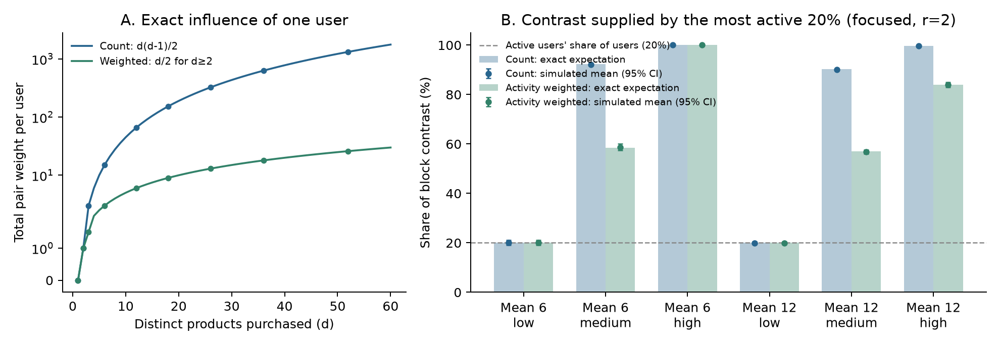
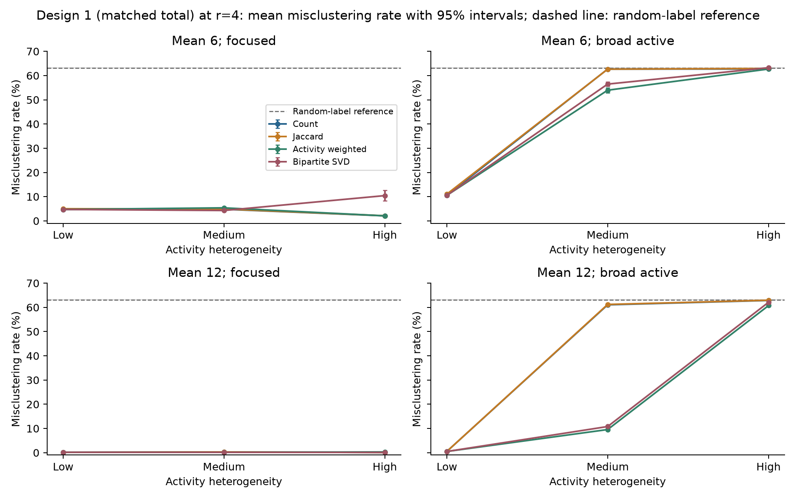

# From Purchases to Communities

## How User Activity Affects Product Network Construction

Tong Zhou, Sia Xie, Yilin Jiang, and Mingjiao Diao  
STAT 236 Course Project | Fall 2026

### Abstract

A user who buys d products adds d(d-1)/2 links to a projected product network, so a few active users can dominate it. We ask when downweighting these users helps recover product communities. We compare shared-purchaser counts (Count), Jaccard similarity, inverse-activity weighting (Weighted), and a normalized bipartite SVD on simulated purchase data with known product categories. In the main experiment (1,200 datasets with matched total purchases), weighting hurts when active users have category preferences: at mean degree 12 with high heterogeneity, Count error is 13.04% and Weighted error is 48.60%. When active users buy without preference, every method is close to the error of random labels, so the main design cannot show whether weighting helps. Post hoc analyses with 4,200 further datasets address this. With 1,000 informative users held fixed, adding 50 preference-free users who buy 48 products each raises Count error from 35.53% to 59.05%, while Weighted error stays at 36.02%. Stronger preference ratios (r=3 and r=4) show the same benefit within the original design. Weighting helps when high activity marks uninformative users and hurts when it marks informative ones.

### 1 Introduction

Purchase records form a bipartite network of users and products. Linking two products whenever the same user buys both gives a product network, and spectral clustering on that network can recover groups of products with similar buyers. These groups reflect purchasing preferences, not necessarily similar functions.

The construction is sensitive to user activity. A user who buys d distinct products contributes d(d-1)/2 product pairs, so a small group of active users can supply most of the network. This suggests downweighting active users, but activity does not measure information. An active buyer who prefers one category adds many within-category links, which help recovery. An active buyer with no preference adds links that, on average, ignore categories.

We ask how activity heterogeneity and preference breadth interact with the choice of projection weights, when inverse-activity weighting improves on Count and Jaccard, and how these projections compare with a normalized SVD of the bipartite matrix. We answer these questions with a controlled simulation that has known labels, matched purchase totals, exact expected edge weights, and paired comparisons. After the main results, we added two post hoc analyses, which Section 7 reports separately.

Newman (2001) weights each collaboration by the inverse of the number of other participants, which motivates our 1/(d-1) weight. Zhou et al. (2007) use resource allocation on bipartite networks; our symmetric weight is related but is not their recommendation method. Dhillon (2001) and Rohe et al. (2016) develop spectral co-clustering for bipartite and directed networks, which motivates our SVD baseline, although it is not an exact implementation of either. Von Luxburg (2007) reviews spectral clustering.

<!-- page -->

### 2 Simulation design

The purchase matrix B has n=1,000 users and p=300 products in K=3 categories of equal size. Each user's preferred category is drawn uniformly and independently of activity, so preference groups are roughly balanced.

Each user buys d_u distinct products, drawn one at a time without replacement. A remaining product in the user's preferred category has weight r_u, and every other product has weight 1. The main experiment uses r=2, which is a sampling weight ratio rather than a fixed share of purchases. Products within a category have equal weights.

Table 1 lists the activity distributions. Within each density setting, total purchases are exactly equal; heterogeneity only changes how purchases are spread across users.

|Mean purchases|Low heterogeneity|Medium heterogeneity|High heterogeneity|
|---|---|---|---|
|6|All users buy 6|80% buy 3; 20% buy 18|80% buy 1; 20% buy 26|
|12|All users buy 12|80% buy 6; 20% buy 36|80% buy 2; 20% buy 52|

Table 1. Exact purchase-count distributions. Counts are assigned to users at random, independently of preferred category.

In the focused condition, every user has r_u=2. In the broad-active condition, the 20% most active users have r_u=1 and the rest keep r_u=2; ties are broken at random. Under low heterogeneity all users are equally active, so a random 20% become broad.

Crossing activity, preference setting, and density gives 12 conditions. Each has 100 independent datasets, and all four methods run on the same matrix. No real purchase data are used.

A pilot with 10 datasets per condition met the proposed difficulty criterion: four conditions had a median error between 5% and 40% for at least one method. Coverage and runtime checks also passed, so we kept the initial design without considering method gaps. The main runs use fresh seeds. The proposal listed r=1.25, 2, and 4 as candidate pilot values; because r=2 already met the criterion, the pilot ran only r=2. The upper value, r=4, was later run as a post hoc sensitivity analysis (Section 7).


Figure 1. An illustrative small simulated network, separate from the main experiment. Colors indicate true product categories. The left panel shows 12 of 40 users; the right panel shows the weighted projection for all 40 users and 30 products.

<!-- page -->

### 3 Methods and theoretical calculations

For distinct products i and j, let S_ij=sum_u B_ui B_uj and b_i=sum_u B_ui. We construct three symmetric product networks:

$$ W_count(i,j) = S_ij $$

$$ W_J(i,j) = S_ij / (b_i + b_j - S_ij) $$

$$ W_weighted(i,j) = sum over u with d_u >= 2 of B_ui B_uj / (d_u - 1) $$

Jaccard is zero when its denominator is zero. All diagonals are set to zero, and no edges are thresholded. For each projection W with row sums D, we take the K eigenvectors of D^(-1/2) W D^(-1/2) with the largest eigenvalues, normalize the nonzero rows, and run k-means with 20 starts and a recorded seed. Products with zero strength or a zero embedding row stay unassigned.

The SVD baseline uses M=Du^(-1/2) B Dp^(-1/2), where Du and Dp hold user and product degrees. After removing zero-degree rows and columns, we keep the leading K right singular vectors, normalize their nonzero rows, and run the same k-means. Unlike the three projections, this baseline keeps the diagonal of M-transpose M. All methods use the true K.

Let s=p/K, and let C_uk be the number of products user u buys from category k. Because products within a category are exchangeable, the probability that user u buys a given pair is

$$ q_same = E[C_uk(C_uk - 1)] / [s(s - 1)] $$

$$ q_different = E[C_uk C_ul] / s squared, for k different from l $$

Expected Count weights sum these probabilities over users; expected Weighted weights divide each user's term by d_u-1 when d_u>=2. We compute the category-count moments exactly by dynamic programming under the actual sampling scheme and average over the uniform preferred category (Appendix A).

A user with r_u=1 buys a uniform random subset, so every pair has inclusion probability d_u(d_u-1)/[p(p-1)] and the user adds no expected within-minus-between contrast. In total, a user with d_u>=2 contributes pair weight d_u(d_u-1)/2 under Count and d_u/2 under Weighted; users with d_u<2 contribute nothing. Count influence therefore grows quadratically with activity and Weighted influence linearly. This describes total influence; it is not a clustering guarantee.

For Jaccard, we approximate the expected weight by the ratio of expected shared counts to expected union counts and check the approximation against simulation. The three projections use different units, so their raw contrasts cannot be compared directly.

Figure 2 shows what this means for the category signal in the focused r=2 conditions. At mean 12, the most active 20% of users supply 90.26% of the expected Count contrast under medium heterogeneity and 99.63% under high heterogeneity; under Weighted the shares fall to 56.98% and 83.99%. Simulated shares from the recorded main datasets agree with these exact values to within 0.2 points.



Figure 2. User influence. (A) Exact total pair weight from one user who buys d distinct products; points mark purchase counts used in the design. (B) Share of the within-minus-between edge contrast supplied by the most active 20% of users in focused r=2 conditions. Bars are exact expectations; points are means over the 100 recorded main datasets per condition, with 95% intervals. Under low heterogeneity the active 20% are a random subset. In broad-active conditions they add no expected contrast.

<!-- page -->

### 4 Community recovery

The primary metric is the misclustering rate after the best matching of cluster labels to categories. Unassigned products count as errors, and the denominator is all 300 products. Secondary metrics are ARI among assigned products, coverage, edge contrasts, product-strength variation, and runtime. Error bars are 95% Monte Carlo intervals for the mean over 100 datasets.


Figure 3. Mean misclustering rate across activity heterogeneity, with 95% Monte Carlo confidence intervals. Columns distinguish preference settings; rows distinguish mean purchase counts. Every point summarizes 100 datasets. Lower values indicate better recovery. Methods are offset slightly within each heterogeneity level so that overlapping points stay visible; Count and Jaccard differ by at most 1.03 points. The gray line marks the random-label reference (62.9% to 63.4%) estimated in Section 7.

Focused active users improve Count and Jaccard recovery. At mean 12, Count error falls from 35.51% under low heterogeneity to 22.36% under medium and 13.04% under high heterogeneity; Jaccard gives 36.33%, 22.65%, and 13.15%. Weighted moves the other way, at 35.31%, 39.05%, and 48.60%, and SVD is similar at 35.46%, 37.01%, and 47.75%.

At mean 6 the pattern is weaker. Count improves from 59.77% to 53.17% to 41.28%, and Weighted gives 59.76%, 58.81%, and 41.23%. At high heterogeneity the two coincide, because every user who buys more than one product buys exactly 26.

Broad-active conditions recover poorly. At mean 12, Count errors are 48.53%, 62.60%, and 62.94% across heterogeneity levels; at mean 6 they are 60.54%, 62.83%, and 62.87%. For comparison, randomly permuted labels give 62.86% to 63.45% (Section 7). Under medium and high heterogeneity, every broad-active cell is within about three points of that range for every method, so these cells show little recovery. All methods assign every product, so the errors come from wrong assignments rather than missing coverage.

<!-- page -->

### 5 Paired effects of activity weighting

Paired differences compare methods on the same dataset. We report Count error minus Weighted error, so positive values favor Weighted. Table 2 gives the differences at mean 12 in percentage points.

|Preferences|Activity|Count minus Weighted|95% Monte Carlo interval|
|---|---|---|---|
|Focused|Low|0.21|0.01 to 0.41|
|Focused|Medium|-16.69|-18.19 to -15.18|
|Focused|High|-35.57|-36.99 to -34.14|
|Broad active|Low|-0.01|-0.06 to 0.04|
|Broad active|Medium|2.36|1.77 to 2.96|
|Broad active|High|-0.04|-0.49 to 0.42|

Table 2. Paired mean error differences over 100 datasets per condition, with unadjusted 95% Monte Carlo intervals.


Figure 4. Paired Count-minus-Weighted differences for both purchase densities. Zero marks equal mean error. Negative values favor Count.

Weighting has a clear cost when active users are focused: 16.69 points at medium and 35.57 points at high heterogeneity. Its clearest gains are in broad-active conditions at medium heterogeneity, 2.36 points at mean 12 and 0.70 points at mean 6, and both leave errors within about three points of the permutation reference. At high heterogeneity the differences are near zero. At low heterogeneity, Count and Weighted differ by a constant factor and give the same normalized matrix, so their small differences reflect numerical and k-means variation.

Weighting therefore balances two effects. It suppresses pairs that carry no category information, and it discards repeated evidence from focused buyers. In the main design the second effect dominates. In broad-active conditions, the possible gain is limited by how little information the remaining users provide.

<!-- page -->

### 6 Diagnostics and comparison with direct SVD

At mean 6 with high heterogeneity and broad active users, the 800 preference-bearing users each buy one product and create no pairs. The 200 users who buy 26 products have r_u=1 and add no expected contrast. Count and Weighted therefore have zero expected block contrast, and no reweighting can create it.

At mean 12 with high heterogeneity, focused users buy two products each and broad users buy 52, so some pair information remains but it is sparse. A broad user contributes 1,326 pairs under Count and 26 under Weighted, against one for a focused user, so broad users supply about 99.70% and 86.67% of pair weight. Weighting reduces their dominance but does not remove it.


Figure 5. Simulated mean within-minus-between edge weights versus theoretical values, with dataset-level Monte Carlo intervals. Each panel uses its own units. The dashed line indicates agreement. Jaccard uses an approximate expected contrast.

Simulated contrasts match the exact calculations. At mean 12 with focused high heterogeneity, Count's theoretical contrast is 0.9020 and its simulated mean is 0.9075; for Weighted the values are 0.02098 and 0.02116. The Jaccard ratio approximation is within 0.23% of the simulated within- and between-category means in every condition.

Count and Jaccard are nearly interchangeable here: their mean edge-rank correlation is 0.9746, and their condition-level mean errors differ by at most 1.03 points. Their partitions still differ, with mean agreement ARI 0.7012. Equal product popularity explains the similarity; we did not test unequal popularity.

SVD offers no general advantage. In the focused high-heterogeneity setting at mean 12, its error exceeds Count's by 34.71 points (paired 95% interval 33.22 to 36.20). The identity M-transpose M=Dp^(-1/2) B-transpose Du^(-1) B Dp^(-1/2) shows why it often tracks Weighted: it weights each user by 1/d_u, close to Weighted's 1/(d_u-1). The two differ mainly for single-purchase users, who carry no pair information but still enter Du, Dp, and the diagonal. At mean 6 with focused high heterogeneity, 800 such users push SVD to 59.70% error while Count and Weighted are near 41%. A post hoc ablation confirms this (Appendix F): rerunning the unchanged SVD on the same recorded datasets without single-purchase users lowers its error to 41.27%, matching Count, and the r=3 sensitivity cell behaves the same way. At mean 12 no user buys only one product, the ablation changes nothing, and SVD's gap to Count instead reflects its Weighted-like 1/d_u user weighting.

<!-- page -->

### 7 Exploratory supplementary analyses

After reviewing the main results and suggestions from an AI-assisted review of them, we designed two supplementary analyses and recorded the design before running them. A third grid at r=4, the proposal's upper pilot value, was added later with its own recorded design. They are post hoc and are reported separately from the main experiment, whose proposal, settings, and results are unchanged. All use the locked package versions and 100 replicates per condition.

**Stronger preferences.** We repeat the full 12-cell grid with r=3 (root seed 23604) and r=4 (root seed 23607). At mean 12 with medium heterogeneity and broad active users, the methods now separate. At r=3, Count and Jaccard errors are 62.46% and 62.33%, while Weighted gives 34.77% and SVD 38.00%; the paired Count-minus-Weighted difference is 27.69 points (95% interval 26.13 to 29.25). At r=4, Count gives 61.05% and Weighted 9.55%, a difference of 51.50 points (50.84 to 52.15). Focused cells become easy, so the cost of weighting shrinks: at r=4, Count, Jaccard, and Weighted errors are below 5.4% in every focused cell. Appendix C lists both grids.

**Fixed information, added background.** The main design keeps total purchases fixed, so making active users broad also takes purchases from informative users. The separation experiment removes this confound. It fixes 1,000 informative users in one of two settings, (m=12, r=2) or (m=6, r=3), and adds A=50 or 200 preference-free users who each buy D products, with D/m=1, 2, 4, or 8. With one A=0 baseline per setting, this gives 18 cells and 1,800 datasets (root seed 23605). Within a replicate, the informative matrix is identical across cells and the background is nested. Because background users add purchases, this experiment answers a different question from the matched-total main design.


Figure 6. Paired Weighted-minus-Count error differences in percentage points under fixed informative purchases. Negative values favor weighting. Recovery curves and all means are in Appendices D and E.

Weighting protects recovery from active background buyers. With m=12, r=2, A=50, and D=48, Count error rises from the 35.53% baseline to 59.05%, while Weighted stays at 36.02%; the paired difference is 23.03 points (21.39 to 24.66). With m=6, r=3, A=50, and D=24, Count reaches 56.83% and Weighted 21.63%, against a 20.55% baseline; the difference is 35.20 points (33.93 to 36.48). When D=m, background users are exactly as active as informative users, so weighting cannot single them out, and Count and Weighted give identical errors.

As a reference for no recovery, we permute the true labels 20 times per dataset and recompute the matched error; cell means range from 62.86% to 63.45%, and the r=4 cells fall within this range. All methods within a dataset share one k-means seed. Intervals are over independent replicates and are not adjusted for multiplicity; cells within a separation replicate share data and are correlated.

<!-- page -->

### 8 Discussion and reproducibility

Activity heterogeneity amplifies whatever behavior active users have. When they are focused, concentrated activity strengthens Count and Jaccard, and weighting discards that evidence. When they are broad, the main design also takes purchases from informative users, so its poor recovery cannot show whether weighting suppresses background noise.

The post hoc analyses answer that question. With r=3, weighting lowers error by about 28 points in the medium-heterogeneity broad-active condition at mean 12, and with r=4 by about 52 points. With informative purchases held fixed, Weighted and SVD stay much closer to their no-background baselines while Count and Jaccard approach the permutation reference. Weighting helps only when activity separates uninformative users from informative ones: background buyers who are no more active than everyone else receive the same weight. Together, the main and supplementary results answer our second question: weighting helps when high activity marks uninformative users and hurts when it marks informative ones. For the third question, normalized SVD behaves much like Weighted and offers no general advantage.

The model has balanced categories, equal product weights within categories, single-category preferences, and known K, and we have no real purchase data. Projected edges are dependent, so we do not apply an independent-edge detection threshold. The supplementary settings were chosen after seeing the main results; their fresh simulations quantify those settings but do not remove the selection. The two separation scenarios change both m and r, so they cannot isolate either parameter. Further work could study mixed preferences, unequal product popularity, preference strengths below r=2 (such as the proposal's 1.25), and ablations of the SVD normalization and diagonal.

All parameters, dataset and k-means seeds, software versions, and checkpoints are recorded. Root seeds are 23601 for the pilot, 23603 for the main experiment, 23604, 23605, and 23607 for the supplementary analyses, and 23606 for permutations. Main datasets keep their original method seeds; supplementary methods share one seed per dataset so that equivalent matrices give identical results. Hash checks confirm that the proposal and main results are unchanged, and five core tests, three supplementary tests, an exact reproduction check in the SVD ablation, and audits of saved results, pairing, and intervals pass. Main-experiment runtimes per dataset are about 12.5 ms for Count, 12.8 ms for Jaccard, 14.8 ms for Weighted, and 48.2 ms for SVD, excluding data generation and diagnostics.

Activity should be read together with preference. Downweighting active buyers removes their noise when they buy at random, discards the strongest evidence when they are focused, and cannot recover information that the remaining users do not supply.

<!-- page -->

### References

Dhillon, I. S. (2001). Co-clustering documents and words using bipartite spectral graph partitioning. Proceedings of the Seventh ACM SIGKDD International Conference on Knowledge Discovery and Data Mining, 269-274. https://doi.org/10.1145/502512.502550

Newman, M. E. J. (2001). Scientific collaboration networks. II. Shortest paths, weighted networks, and centrality. Physical Review E, 64, 016132. https://doi.org/10.1103/PhysRevE.64.016132

Rohe, K., Qin, T., and Yu, B. (2016). Co-clustering directed graphs to discover asymmetries and directional communities. Proceedings of the National Academy of Sciences, 113(45), 12679-12684. https://doi.org/10.1073/pnas.1525793113

von Luxburg, U. (2007). A tutorial on spectral clustering. Statistics and Computing, 17, 395-416. https://doi.org/10.1007/s11222-007-9033-z

Zhou, T., Ren, J., Medo, M., and Zhang, Y.-C. (2007). Bipartite network projection and personal recommendation. Physical Review E, 76, 046115. https://doi.org/10.1103/PhysRevE.76.046115

### Reproducing the analysis

From the project directory, create a Python 3.11 environment and install requirements-lock.txt. The following commands use the frozen initial design and saved checkpoints.

```bash
python -m unittest discover -s tests -v
python run_experiments.py --stage main --frozen-config frozen_config.json \
  --workers 4 --resume
python run_experiments.py --stage main --analyze-only
python scripts/build_report_assets.py
python run_experiments.py --stage supplement --workers 4 --resume
python scripts/validate_supplement.py
python scripts/build_supplement_materials.py
python scripts/svd_ablation.py --workers 4
```

For a fresh independent run with the same design, add a new --seed and --output directory and omit --resume. The delivered outputs/main directory contains results.csv, diagnostics.csv, summary.csv, paired_differences.csv, manifest.json, and dataset checkpoints. The experiment manifest is the authoritative record of the completed main design.

<!-- page -->

### Appendix A Exact category count recurrence

For a user with d purchases and preference ratio r, let P_t(c) be the probability of selecting c preferred-category products after t draws. Let s=p/K and h=p-s. Set P_0(0)=1. Conditional on state c, the next product is preferred with probability

$$ a_t(c) = r(s-c) / [r(s-c) + h-(t-c)] $$

The updates are P_(t+1)(c+1) += P_t(c) a_t(c) and P_(t+1)(c) += P_t(c)[1-a_t(c)]. Only feasible states are visited. At t=d, let C denote the preferred count and R=d-C. Conditional on C, nonpreferred products are a uniform R-subset of h products. For any one nonpreferred category, its ordered-pair moment is E[R(R-1)] s(s-1)/[h(h-1)]. Thus, defining

$$ A = E[C(C-1)] + (K-1) E[R(R-1)] s(s-1) / [h(h-1)] $$

and averaging over a uniform preferred category gives q_in=A/[K s(s-1)] and q_out=[d(d-1)-A]/[K(K-1)s squared]. Summing user contributions gives the Count and Weighted expectations. This averages over preferred-category assignments; it is not the expectation conditional on a particular realized assignment.

### Appendix B Complete mean misclustering rates

All entries below are percentages, based on 100 datasets per condition. Broad active means that the most active 20% have r=1. Full precision, standard errors, and intervals are in the accompanying CSV files.

|Mean|Activity|Preferences|Count|Jaccard|Weighted|SVD|
|---|---|---|---|---|---|---|
|6|Low|Focused|59.77|59.94|59.76|59.75|
|6|Low|Broad active|60.54|60.83|60.56|60.54|
|6|Medium|Focused|53.17|53.92|58.81|58.84|
|6|Medium|Broad active|62.83|62.91|62.13|62.60|
|6|High|Focused|41.28|42.31|41.23|59.70|
|6|High|Broad active|62.87|62.64|62.87|63.21|
|12|Low|Focused|35.51|36.33|35.31|35.46|
|12|Low|Broad active|48.53|49.17|48.55|48.48|
|12|Medium|Focused|22.36|22.65|39.05|37.01|
|12|Medium|Broad active|62.60|62.84|60.23|60.28|
|12|High|Focused|13.04|13.15|48.60|47.75|
|12|High|Broad active|62.94|62.94|62.97|63.16|


<!-- page -->

### Appendix C Exploratory sensitivity at r equal to 3 and 4

The full original grid was rerun at r=3 and at r=4, each with 100 fresh datasets per cell. Main r=2 results remain unchanged. All rates below are percentages. Supplementary k-means seeds are shared across methods within a dataset; initialization differences in the original main analysis are retained in its records.


Figure 7. Full r=3 sensitivity grid. Bars show 95% Monte Carlo intervals over 100 datasets. This is a post hoc sensitivity analysis; some focused settings are near perfect recovery, and all cells are retained. The dashed line marks the random-label reference.

|Mean|Activity|Preferences|Count|Jaccard|Weighted|SVD|
|---|---|---|---|---|---|---|
|6|Low|Focused|20.24|22.48|20.24|20.24|
|6|Low|Broad active|35.86|39.20|35.86|35.86|
|6|Medium|Focused|14.18|14.53|23.66|21.81|
|6|Medium|Broad active|62.85|62.71|59.81|60.45|
|6|High|Focused|7.62|7.76|7.62|39.34|
|6|High|Broad active|63.05|63.02|63.05|63.54|
|12|Low|Focused|1.60|1.62|1.60|1.60|
|12|Low|Broad active|4.51|4.58|4.51|4.51|
|12|Medium|Focused|2.15|2.16|2.12|1.83|
|12|Medium|Broad active|62.46|62.33|34.77|38.00|
|12|High|Focused|0.85|0.86|4.00|1.58|
|12|High|Broad active|62.92|62.87|62.17|62.95|



Figure 8. Full r=4 sensitivity grid. Bars show 95% Monte Carlo intervals over 100 datasets. This is a post hoc sensitivity analysis; focused settings are near perfect recovery, and all cells are retained. The dashed line marks the random-label reference.

|Mean|Activity|Preferences|Count|Jaccard|Weighted|SVD|
|---|---|---|---|---|---|---|
|6|Low|Focused|4.72|5.01|4.72|4.72|
|6|Low|Broad active|10.51|11.03|10.51|10.51|
|6|Medium|Focused|4.78|4.90|5.38|4.28|
|6|Medium|Broad active|62.66|62.64|53.95|56.47|
|6|High|Focused|2.07|2.12|2.07|10.43|
|6|High|Broad active|62.70|62.91|62.70|63.24|
|12|Low|Focused|0.15|0.14|0.15|0.15|
|12|Low|Broad active|0.49|0.50|0.49|0.49|
|12|Medium|Focused|0.28|0.29|0.15|0.13|
|12|Medium|Broad active|61.05|61.21|9.55|10.80|
|12|High|Focused|0.06|0.06|0.31|0.10|
|12|High|Broad active|62.86|62.95|60.74|62.10|


<!-- page -->

### Appendix D Recovery under fixed informative purchases

Each scenario retains the same informative matrix within a replicate. Background users are uniform buyers with r=1. Prefixes of uniform purchase orders and user sets provide nested exposure levels. The first point in each panel is the shared A=0 baseline. Adding background purchases changes the total data volume; this experiment is not matched in density to the main design.


Figure 9. Fixed-information separation experiment with 100 replicates per condition and 95% Monte Carlo intervals. The informative-only baseline is reused across panels for the same scenario; those displays are not additional independent baseline datasets. The dashed line marks the random-label reference.

As D grows, Count and Jaccard lose accuracy, while Weighted and SVD stay much closer to their informative-only baselines. More background users (larger A) also raise Weighted error, so weighting does not make recovery immune to background. Weighted error does not change monotonically with D, and this should not be read as a benefit of adding background purchases.

Permutation references randomize the balanced truth labels while preserving fitted cluster sizes. Twenty permutations are averaged within each dataset, then summarized across independent replicates. Their uncertainty includes finite permutation simulation. The full method-specific references are in outputs/supplement/separation/permutation_reference.csv and the sensitivity summary table. They are not a theoretical impossibility boundary.

<!-- page -->

### Appendix E Complete separation experiment means

All errors are percentages from 100 replicates. A is the number of extra background users; D is their number of purchases. The setting names identify informative-user purchase count m and preference ratio r. Each scenario has 1,000 informative users. An A=0 baseline is stored once per scenario. Full paired intervals for all six method comparisons are provided in outputs/supplement/separation/paired_differences.csv.

|Setting|A|D|Count|Jaccard|Weighted|SVD|
|---|---|---|---|---|---|---|
|m12_r2|0|12|35.53|36.43|35.53|35.53|
|m12_r2|50|12|37.06|37.37|37.06|37.06|
|m12_r2|50|24|45.92|46.31|36.63|36.75|
|m12_r2|50|48|59.05|59.25|36.02|36.33|
|m12_r2|50|96|61.67|61.81|35.72|36.10|
|m12_r2|200|12|40.75|41.55|40.75|40.75|
|m12_r2|200|24|54.94|55.16|40.19|40.29|
|m12_r2|200|48|61.51|61.37|39.32|39.76|
|m12_r2|200|96|62.00|62.00|36.90|38.27|
|m6_r3|0|6|20.55|22.31|20.55|20.55|
|m6_r3|50|6|21.83|23.47|21.83|21.83|
|m6_r3|50|12|31.72|34.38|21.52|21.77|
|m6_r3|50|24|56.83|57.27|21.63|22.32|
|m6_r3|50|48|61.37|61.60|21.45|22.70|
|m6_r3|200|6|25.44|27.25|25.44|25.44|
|m6_r3|200|12|49.21|50.21|24.84|26.20|
|m6_r3|200|24|61.01|60.91|24.48|26.95|
|m6_r3|200|48|62.32|62.37|23.49|26.40|

<!-- page -->

### Appendix F Post hoc SVD ablation

The ablation regenerates each recorded dataset from its seed, reruns the unchanged bipartite SVD with its recorded k-means seed, and checks that the saved error is reproduced exactly. It then removes users with exactly one purchase and reruns SVD. All products remain assigned.

Table 3. Post hoc SVD ablation on the recorded datasets (100 per cell, mean errors in percent). The last column is SVD error minus SVD error without single-purchase users, with 95% Monte Carlo intervals. Original SVD errors are reproduced exactly.

|Cell|Single-purchase users|Count|Weighted|SVD|SVD without single-purchase users|SVD difference (pp, 95% CI)|
|---|---|---|---|---|---|---|
|Mean 6, high, focused, r=2|800|41.28|41.23|59.70|41.27|18.43 (16.98 to 19.88)|
|Mean 12, high, focused, r=2|0|13.04|48.60|47.75|47.75|0.00 (0.00 to 0.00)|
|Mean 6, high, focused, r=3|800|7.62|7.62|39.34|7.62|31.72 (29.44 to 34.00)|
