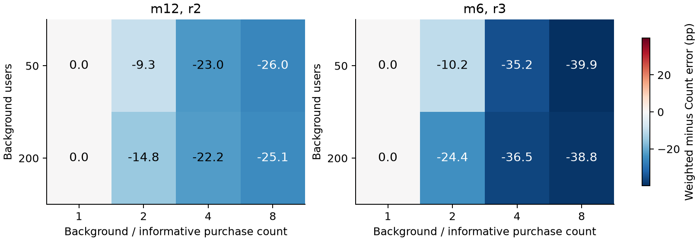
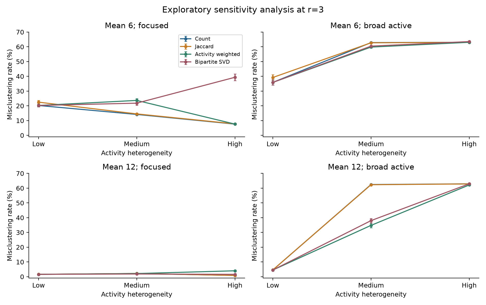
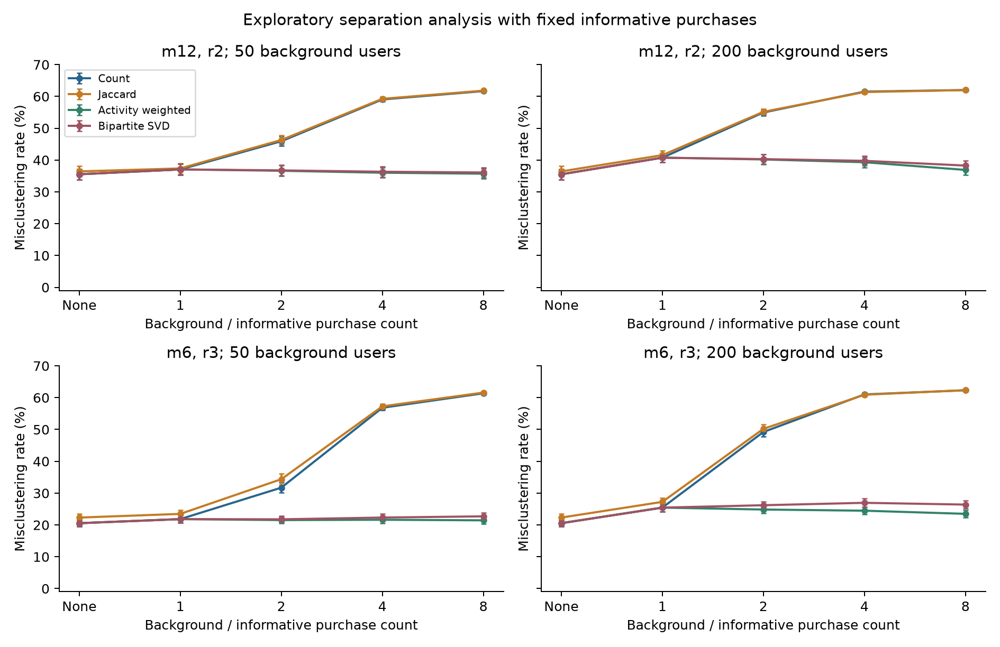

# From Purchases to Communities

## How User Activity Affects Product Network Construction

Tong Zhou, Sia Xie, Yilin Jiang, and Mingjiao Diao  
STAT 236 Course Project | Fall 2026

### Abstract

A user who purchases many products creates many links in a projected product network. Whether this helps community recovery depends on the user's preferences. We compare shared-purchaser counts, Jaccard similarity, inverse-activity weighting, and normalized bipartite SVD. The frozen main design uses 1,200 simulated datasets with matched purchase totals. At mean degree 12 with focused preferences and high heterogeneity, Count has 13.04% mean error versus 48.60% for weighting. We then conduct explicitly post hoc sensitivity and separation analyses on 3,000 additional datasets. The separation design holds informative purchases fixed while adding uniform background buyers. With 1,000 informative users buying 12 products at r=2 and 50 background users buying 48 products, Count error is 59.05% and Weighted error is 36.02%; both are 35.53% without background. Thus weighting can discard useful evidence when active users are focused and protect recovery when activity is concentrated in preference-free buyers. These conditional findings do not establish a universal threshold or method ranking.

### 1 Introduction

User-product purchase records naturally form a bipartite network. Connecting products purchased by the same user creates a product network on which spectral clustering can identify communities. Such communities describe purchasing preferences; they need not correspond to functional similarity between products.

The construction is sensitive to user activity. A user purchasing d distinct products contributes d(d-1)/2 unordered product pairs. A small active group can therefore account for much of the projected network. This motivates downweighting active users, but activity alone does not determine information quality. A frequent buyer with a category preference can create useful within-category connections. A frequent buyer with no preference instead contributes category-independent connections in expectation.

We ask how activity heterogeneity and preference breadth interact with projection weights, when inverse-activity weighting improves on Count and Jaccard, and how these projections compare with a normalized SVD of the bipartite matrix. Our contribution is a controlled implementation and comparison of existing ideas, with known labels, matched purchase totals, exact moment calculations, and paired Monte Carlo uncertainty.

Newman (2001) motivates inverse group-size contributions in projected collaboration networks. Zhou et al. (2007) study resource allocation on bipartite networks, providing related projection context; our symmetric weighting is not their complete recommendation procedure. Dhillon (2001) motivates normalized bipartite spectral representations. Rohe et al. (2016) provide related spectral co-clustering ideas, while von Luxburg (2007) reviews spectral clustering. Our direct SVD baseline is inspired by this literature rather than an exact implementation of either original co-clustering algorithm.

<!-- page -->

### 2 Simulation design

Let B be the binary purchase matrix for n=1,000 users and p=300 products in K=3 equal categories. Product labels are fixed. Users independently receive a uniformly drawn preferred category, independently of activity, giving approximately balanced preference groups.

Each user samples d_u distinct products sequentially without replacement. Available preferred-category products have weight r_u; others have weight 1. The main ratio is r=2. This is a sampling weight ratio, not a fixed ratio of realized category counts. Products within a category have equal weights.

Table 1 specifies activity distributions with exactly matched purchase totals within each density setting. Heterogeneity changes how purchases are concentrated among users.

|Mean purchases|Low heterogeneity|Medium heterogeneity|High heterogeneity|
|---|---|---|---|
|6|All users buy 6|80% buy 3; 20% buy 18|80% buy 1; 20% buy 26|
|12|All users buy 12|80% buy 6; 20% buy 36|80% buy 2; 20% buy 52|

Table 1. Exact purchase-count distributions. Counts are randomly assigned to users independently of preferred category.

In the focused condition, r_u=2 for every user. In the broad-active condition, the most active 20% have r_u=1; others retain r_u=2. Independent random numbers break activity ties. With equal activity, a random 20% subset becomes broad.

The 12 conditions cross activity, preference setting, and density. Each has 100 independent datasets, with all methods evaluated on the same matrix. No real purchase records are used.

A separate pilot used 10 datasets per condition. Four conditions met the proposed difficulty criterion: median error between 0.05 and 0.40 for at least one method. Coverage and runtime checks passed, so we retained the initial design without selecting for method gaps. Main simulations use fresh seeds. Further calibration and unequal-popularity sensitivity analyses were not run.


Figure 1. An illustrative small simulated network, separate from the main experiment. Colors indicate true product categories. The left panel shows 12 of 40 users; the right panel shows the weighted projection for all 40 users and 30 products.

<!-- page -->

### 3 Methods and theoretical calculations

For distinct products i and j, let S_ij=sum_u B_ui B_uj and b_i=sum_u B_ui. We construct three symmetric product networks:

$$ W_count(i,j) = S_ij $$

$$ W_J(i,j) = S_ij / (b_i + b_j - S_ij) $$

$$ W_weighted(i,j) = sum over u with d_u >= 2 of B_ui B_uj / (d_u - 1) $$

Jaccard is zero for a zero denominator. All projection diagonals are set to zero, and weighted edges are not thresholded. For each projection W, let D contain its row sums. We take the K largest algebraic eigenvectors of D^(-1/2) W D^(-1/2), normalize nonzero embedding rows, and apply k-means with 20 initializations and a recorded seed. Zero-strength products and zero embedding rows remain unassigned.

The direct baseline uses M=Du^(-1/2) B Dp^(-1/2), where Du and Dp contain user and product degrees. After removing zero-degree rows and columns, we retain the leading K right singular vectors, normalize their nonzero rows, and apply the same k-means settings. K is fixed at its true value for all methods. This baseline retains the implicit diagonal effect of M-transpose M, unlike the three projections.

Let s=p/K and C_uk denote purchases by user u from category k. Exchangeability within categories gives the conditional probability of purchasing a specified pair:

$$ q_same = E[C_uk(C_uk - 1)] / [s(s - 1)] $$

$$ q_different = E[C_uk C_ul] / s squared, for k different from l $$

Count expectations sum these probabilities over users; Weighted expectations divide each user's contribution by d_u-1 when d_u>=2. We calculate category-count moments by dynamic programming under the actual sequential sampling scheme. Reported block expectations also average over the independently uniform preferred categories. Appendix A gives the recurrence.

For r_u=1, the selected products form a uniform subset, so every distinct pair has inclusion probability d_u(d_u-1)/[p(p-1)]. Such a user adds no expected within-minus-between contrast. Exactly, a user contributes total unordered weight d_u(d_u-1)/2 under Count and d_u/2 under Weighted when d_u>=2; both contributions are zero for d_u<2. These identities establish quadratic versus linear total influence, not a clustering guarantee after normalization.

For Jaccard, we use the ratio of expected shared counts to expected union counts as an approximation. We check it against simulated means and do not identify it with the exact expected ratio. Raw contrasts have different units across projections, so their magnitudes alone cannot rank recovery quality.

<!-- page -->

### 4 Community recovery

The primary metric is misclustering rate after optimal permutation of cluster labels. We count unassigned products as errors and divide by all 300 products. Secondary metrics include ARI among assigned products, assignment coverage, edge contrasts, product-strength variation, and runtime. Each plotted confidence interval is a 95% Student-t Monte Carlo interval for a mean over 100 independent datasets. These are not prediction intervals for individual datasets.


Figure 2. Mean misclustering rate across activity heterogeneity, with 95% Monte Carlo confidence intervals. Columns distinguish preference settings; rows distinguish mean purchase counts. Every point summarizes 100 datasets. Lower values indicate better recovery.

Focused active users substantially improve Count and Jaccard recovery. At mean purchase count 12, Count error decreases from 35.51% under low heterogeneity to 22.36% under medium and 13.04% under high heterogeneity. Jaccard follows closely at 36.33%, 22.65%, and 13.15%. Weighting instead gives 35.31%, 39.05%, and 48.60%; SVD gives 35.46%, 37.01%, and 47.75%.

The sparse focused setting shows a different weighting trajectory: at mean 6, Count improves from 59.77% to 53.17% to 41.28%, whereas Weighted gives 59.76%, 58.81%, and 41.23%. Thus, even within focused preferences, the effect of heterogeneity is not uniformly worsening for Weighted.

Broad-active conditions have substantially poorer recovery. At mean 12, Count errors are 48.53%, 62.60%, and 62.94% across heterogeneity levels. At mean 6, they are 60.54%, 62.83%, and 62.87%. Medium and high heterogeneity both yield weak recovery; the exact ordering is not identical for every method. All methods assign every product, and no main-experiment product is isolated. Poor recovery therefore reflects incorrect assignments rather than missing coverage.

<!-- page -->

### 5 Paired effects of activity weighting

Paired differences isolate the method comparison within each generated dataset. Define the difference as Count error minus Weighted error. Positive values favor Weighted; negative values favor Count. Table 2 reports differences in percentage points for mean purchase count 12.

|Preferences|Activity|Count minus Weighted|95% Monte Carlo interval|
|---|---|---|---|
|Focused|Low|0.21|0.01 to 0.41|
|Focused|Medium|-16.69|-18.19 to -15.18|
|Focused|High|-35.57|-36.99 to -34.14|
|Broad active|Low|-0.01|-0.06 to 0.04|
|Broad active|Medium|2.36|1.77 to 2.96|
|Broad active|High|-0.04|-0.49 to 0.42|

Table 2. Paired mean error differences over 100 datasets per condition. Intervals are unadjusted for multiple comparisons; statistical detectability does not imply a large practical effect.


Figure 3. Paired Count-minus-Weighted differences for both purchase densities. Zero marks equal mean error. Negative values favor Count.

Weighting helps most clearly at medium heterogeneity with broad active users: the gain is 2.36 percentage points at mean 12 and 0.70 points at mean 6, with intervals excluding zero. These improvements leave errors near 60%, so they do not indicate successful category recovery. At high heterogeneity, the differences are small and intervals include zero. At low heterogeneity, Count and Weighted matrices differ only by a common scalar and have the same normalized spectral matrix in exact arithmetic. Small measured discrepancies can arise from numerical and k-means initialization differences; they are not evidence for a structural weighting advantage.

The interpretation is that activity weighting trades off suppression of category-independent pair contributions against retention of useful repeated evidence. This tradeoff is unfavorable when high-degree users remain focused. The observed gains in broad-active conditions are limited by the information supplied by the remaining users.

<!-- page -->

### 6 Diagnostics and comparison with direct SVD

At mean 6 with high heterogeneity, the 800 preference-bearing users each purchase one product in the broad-active condition. They create no product pairs. The 200 users purchasing 26 products have r_u=1, giving zero expected category contrast. Count and Weighted therefore have exactly zero population block contrast. This is an information limitation for the pair projections, and explains why reducing active-user weights cannot create the missing contrast.

At mean 12 with high heterogeneity, focused users each purchase two products while broad users each purchase 52. Useful pair information remains, but it is sparse. A broad user's total Count contribution is 1,326 unordered pair units, compared with one unit for a focused user. Weighted contributions become 26 and one. The corresponding broad-user shares are about 99.70% and 86.67%. Weighting reduces their dominance, but they still supply most projected pair mass. Pair mass is a mechanism diagnostic, not a substitute for spectral signal-to-noise analysis.


Figure 4. Simulated mean within-minus-between edge weights versus theoretical values, with dataset-level Monte Carlo intervals. Each panel uses its own units. The dashed line indicates agreement. Jaccard uses an approximate expected contrast.

Count and Weighted simulated contrasts track the theoretical calculations. For example, at mean 12 with focused high heterogeneity, Count's theoretical contrast is 0.9020 and its simulated mean is 0.9075; Weighted's corresponding values are 0.02098 and 0.02116. Across conditions, the relative discrepancy between simulated mean Jaccard within or between weights and the ratio approximation is below 0.23%. Agreement here supports the approximation in this design, without making it an exact identity.

Across conditions, mean product-strength coefficients of variation are 0.199 for Count, 0.125 for Jaccard, and 0.187 for Weighted. Lower strength variation alone does not ensure better recovery. Count and Jaccard have mean edge-rank correlation 0.9746 across datasets. Their largest condition-level mean error gap is 1.03 percentage points. Nevertheless, their mean clustering agreement ARI is 0.7012, so similar average recovery does not imply identical partitions. Equal expected product popularity helps explain the similar edge rankings; unequal popularity remains untested.

SVD performs similarly to Weighted in several conditions. In the focused high-heterogeneity setting at mean 12, SVD error exceeds Count by 34.71 percentage points, with paired 95% interval 33.22 to 36.20. At mean 6 in the same preference/activity setting, SVD error is 59.70%, while Count and Weighted are near 41%. No general SVD advantage is observed.

The identity M-transpose M=Dp^(-1/2) B-transpose Du^(-1) B Dp^(-1/2) connects SVD to a weighted Gram matrix. It clarifies their related normalization choices, but different user weights and diagonal treatments prevent attributing the entire performance gap to one operation.

<!-- page -->

### 7 Exploratory supplementary analyses

After inspecting the main results and external exploratory descriptions, we specified two supplementary analyses and recorded their design before fresh verification runs. These are post hoc analyses, not prespecified main experiments. The original proposal, frozen r=2 settings, and main result files are unchanged. Both additions use the original numerical dependency environment and 100 replicates per condition.

The r=3 sensitivity analysis repeats the complete 12-cell grid with root seed 23604. At mean 12, medium heterogeneity, and broad active users, mean errors are 62.46% for Count, 62.33% for Jaccard, 34.77% for Weighted, and 38.00% for SVD. The paired Count-minus-Weighted advantage is 27.69 percentage points (95% interval 26.13 to 29.25). Stronger preferences make some focused cells easy: at mean 12 and high heterogeneity, Count and Weighted errors are 0.85% and 4.00%. Appendix C reports every r=3 condition.

The separation experiment fixes 1,000 informative users at either (m=12, r=2) or (m=6, r=3). It adds A=50 or 200 preference-free users with D/m=1, 2, 4, or 8, plus one A=0 baseline per setting. This gives 18 cells and 1,800 datasets using root seed 23605. Informative matrices are identical across exposure levels within each replicate; background users and purchases are nested. Total purchases and user counts increase, so this answers a different question from the matched-total main design.



Figure 5. Exploratory paired Weighted-minus-Count error differences in percentage points. Negative values favor weighting. These heatmaps summarize specific simulated settings, not a theoretical phase boundary. Recovery curves and complete means are in Appendices D and E.

With m=12, r=2, A=50, and D=48, Count error is 59.05% versus 36.02% for Weighted. The paired advantage is 23.03 points (95% interval 21.39 to 24.66); the no-background error is 35.53% for both. With m=6, r=3, A=50, and D=24, Count and Weighted errors are 56.83% and 21.63%, versus a 20.55% baseline. The paired advantage is 35.20 points (33.93 to 36.48).

All supplementary methods share a recorded k-means seed within each dataset. Count and Weighted give identical errors when D=m, as required by their equivalent normalized matrices. Twenty truth-label permutations per dataset provide a method-specific reference using optimal matching. Cell mean permutation errors range from 62.86% to 63.45% across these supplementary analyses; this is an estimated reference, not a universal 63% line. Within-cell intervals use independent replicates and are unadjusted for multiplicity. Cells within a separation replicate share data and are correlated.

<!-- page -->

### 8 Discussion and reproducibility

Activity heterogeneity changes the leverage of whichever behavior is concentrated in active users. In the frozen r=2 experiment, focused active users improve Count and Jaccard recovery, whereas weighting can discard their evidence. Broad-active high heterogeneity also reduces purchases by informative users, so its poor recovery cannot by itself establish that weighting fails to suppress background interference.

The post hoc analyses clarify this distinction. At r=3, medium-heterogeneity broad-active conditions reveal a substantial weighting benefit. In the separation experiment, the informative matrix stays fixed while extra preference-free purchases are added; weighting and normalized SVD retain much more recovery accuracy than Count or Jaccard in the tested high-activity background settings. The r=2 main study and supplementary analyses address complementary aspects of the original questions. None establishes that D>m alone guarantees a benefit, or identifies a universal crossover in preference strength.

Our conclusions apply to a model with balanced categories, equal within-category product weights, single-category preferences, and known K. We have no real purchase-data validation. Edges in a projection are dependent, so we do not import an independent-edge SBM detection threshold. Zero expected contrast is exact in the sparse high-heterogeneity broad-active cell with one purchase per informative user; it does not imply absence of information in every high-heterogeneity cell. At mean 12, informative users each buy two products and still provide some pair information.

The supplementary settings were motivated by observed results and external exploratory descriptions. Their fresh simulations quantify those selected settings; they do not remove the exploratory selection. The two separation scenarios vary both m and r, so comparisons across scenarios cannot isolate either parameter. We report the full chosen grids, unadjusted paired intervals, and label-permutation references. Further work could study mixed preferences, unequal product popularity, additional preference strengths, and controlled diagonal or normalization ablations.

Reproduction materials record parameters, dataset and k-means seeds, software versions, and atomic checkpoints. The original pilot and main root seeds remain 23601 and 23603. Supplementary generation roots are 23604 and 23605, with permutation namespace 23606. Main datasets use their original independent method seeds; supplementary methods share initialization seeds to check matrix equivalence. Hash checks verify the original proposal and main results are unchanged. Five core tests and three supplementary tests pass, together with saved-result, pairing, and interval audits.

Main-experiment mean method runtimes are approximately 12.5 ms for Count, 12.8 ms for Jaccard, 14.8 ms for Weighted, and 48.2 ms for SVD. These include construction or decomposition and clustering, excluding generation, theory, and diagnostics, with four processes and one numerical-library thread per worker. Timings depend on machine load. Raw purchase matrices can be regenerated from seeds; an example is supplied. The principal conclusion is conditional: downweighting helps when it suppresses the tested preference-free active buyers without discarding the informative purchases, and can hurt when active buyers carry the strongest category evidence.

<!-- page -->

### References

Dhillon, I. S. (2001). Co-clustering documents and words using bipartite spectral graph partitioning. Proceedings of the Seventh ACM SIGKDD International Conference on Knowledge Discovery and Data Mining, 269-274. https://doi.org/10.1145/502512.502550

Newman, M. E. J. (2001). Scientific collaboration networks. II. Shortest paths, weighted networks, and centrality. Physical Review E, 64, 016132. https://doi.org/10.1103/PhysRevE.64.016132

Rohe, K., Qin, T., and Yu, B. (2016). Co-clustering directed graphs to discover asymmetries and directional communities. Proceedings of the National Academy of Sciences, 113(45), 12679-12684. https://doi.org/10.1073/pnas.1525793113

von Luxburg, U. (2007). A tutorial on spectral clustering. Statistics and Computing, 17, 395-416. https://doi.org/10.1007/s11222-007-9033-z

Zhou, T., Ren, J., Medo, M., and Zhang, Y.-C. (2007). Bipartite network projection and personal recommendation. Physical Review E, 76, 046115. https://doi.org/10.1103/PhysRevE.76.046115

### Reproducing the analysis

From the project directory, create a Python 3.11 environment and install requirements-lock.txt. The following commands use the frozen initial design and saved checkpoints.

```bash
python -m unittest discover -s tests -v
python run_experiments.py --stage main --frozen-config frozen_config.json \
  --workers 4 --resume
python run_experiments.py --stage main --analyze-only
python scripts/build_report_assets.py
python run_experiments.py --stage supplement --workers 4 --resume
python scripts/validate_supplement.py
python scripts/build_supplement_materials.py
```

For a fresh independent run with the same design, add a new --seed and --output directory and omit --resume. The delivered outputs/main directory contains results.csv, diagnostics.csv, summary.csv, paired_differences.csv, manifest.json, and dataset checkpoints. The experiment manifest is the authoritative record of the completed main design.

<!-- page -->

### Appendix A Exact category count recurrence

For a user with d purchases and preference ratio r, let P_t(c) be the probability of selecting c preferred-category products after t draws. Let s=p/K and h=p-s. Set P_0(0)=1. Conditional on state c, the next product is preferred with probability

$$ a_t(c) = r(s-c) / [r(s-c) + h-(t-c)] $$

The updates are P_(t+1)(c+1) += P_t(c) a_t(c) and P_(t+1)(c) += P_t(c)[1-a_t(c)]. Only feasible states are visited. At t=d, let C denote the preferred count and R=d-C. Conditional on C, nonpreferred products are a uniform R-subset of h products. For any one nonpreferred category, its ordered-pair moment is E[R(R-1)] s(s-1)/[h(h-1)]. Thus, defining

$$ A = E[C(C-1)] + (K-1) E[R(R-1)] s(s-1) / [h(h-1)] $$

and averaging over a uniform preferred category gives q_in=A/[K s(s-1)] and q_out=[d(d-1)-A]/[K(K-1)s squared]. Summing user contributions gives the Count and Weighted expectations. This averages over preferred-category assignments; it is not the expectation conditional on a particular realized assignment.

### Appendix B Complete mean misclustering rates

All entries below are percentages, based on 100 datasets per condition. Broad active means that the most active 20% have r=1. Full precision, standard errors, and intervals are in the accompanying CSV files.

|Mean|Activity|Preferences|Count|Jaccard|Weighted|SVD|
|---|---|---|---|---|---|---|
|6|Low|Focused|59.77|59.94|59.76|59.75|
|6|Low|Broad active|60.54|60.83|60.56|60.54|
|6|Medium|Focused|53.17|53.92|58.81|58.84|
|6|Medium|Broad active|62.83|62.91|62.13|62.60|
|6|High|Focused|41.28|42.31|41.23|59.70|
|6|High|Broad active|62.87|62.64|62.87|63.21|
|12|Low|Focused|35.51|36.33|35.31|35.46|
|12|Low|Broad active|48.53|49.17|48.55|48.48|
|12|Medium|Focused|22.36|22.65|39.05|37.01|
|12|Medium|Broad active|62.60|62.84|60.23|60.28|
|12|High|Focused|13.04|13.15|48.60|47.75|
|12|High|Broad active|62.94|62.94|62.97|63.16|


<!-- page -->

### Appendix C Exploratory sensitivity at r equal to 3

The full original grid was rerun at r=3 using 100 fresh datasets per cell. Main r=2 results remain unchanged. All rates below are percentages. Supplementary k-means seeds are shared across methods within a dataset; initialization differences in the original main analysis are retained in its records.



Figure 6. Full r=3 sensitivity grid. Bars show 95% Monte Carlo intervals over 100 datasets. This is a post hoc sensitivity analysis; some focused settings are near perfect recovery, and all cells are retained.

|Mean|Activity|Preferences|Count|Jaccard|Weighted|SVD|
|---|---|---|---|---|---|---|
|6|Low|Focused|20.24|22.48|20.24|20.24|
|6|Low|Broad active|35.86|39.20|35.86|35.86|
|6|Medium|Focused|14.18|14.53|23.66|21.81|
|6|Medium|Broad active|62.85|62.71|59.81|60.45|
|6|High|Focused|7.62|7.76|7.62|39.34|
|6|High|Broad active|63.05|63.02|63.05|63.54|
|12|Low|Focused|1.60|1.62|1.60|1.60|
|12|Low|Broad active|4.51|4.58|4.51|4.51|
|12|Medium|Focused|2.15|2.16|2.12|1.83|
|12|Medium|Broad active|62.46|62.33|34.77|38.00|
|12|High|Focused|0.85|0.86|4.00|1.58|
|12|High|Broad active|62.92|62.87|62.17|62.95|


<!-- page -->

### Appendix D Recovery under fixed informative purchases

Each scenario retains the same informative matrix within a replicate. Background users are uniform buyers with r=1. Prefixes of uniform purchase orders and user sets provide nested exposure levels. The first point in each panel is the shared A=0 baseline. Adding background purchases changes the total data volume; this experiment is not matched in density to the main design.



Figure 7. Fixed-information separation experiment with 100 replicates per condition and 95% Monte Carlo intervals. The informative-only baseline is reused across panels for the same scenario; those displays are not additional independent baseline datasets.

As D grows, Count and Jaccard become less accurate in the tested settings, while Weighted and SVD remain much closer to their informative-only baselines. Increasing A also degrades Weighted, so weighting does not make recovery immune to background users. The nonmonotone changes in Weighted error across D should not be interpreted as universal improvement from adding more background purchases.

Permutation references randomize the balanced truth labels while preserving fitted cluster sizes. Twenty permutations are averaged within each dataset, then summarized across independent replicates. Their uncertainty includes finite permutation simulation. The full method-specific references are in outputs/supplement/separation/permutation_reference.csv and the sensitivity summary table. They are not a theoretical impossibility boundary.

<!-- page -->

### Appendix E Complete separation experiment means

All errors are percentages from 100 replicates. A is the number of extra background users; D is their number of purchases. The setting names identify informative-user purchase count m and preference ratio r. Each scenario has 1,000 informative users. An A=0 baseline is stored once per scenario. Full paired intervals for all six method comparisons are provided in outputs/supplement/separation/paired_differences.csv.

|Setting|A|D|Count|Jaccard|Weighted|SVD|
|---|---|---|---|---|---|---|
|m12_r2|0|12|35.53|36.43|35.53|35.53|
|m12_r2|50|12|37.06|37.37|37.06|37.06|
|m12_r2|50|24|45.92|46.31|36.63|36.75|
|m12_r2|50|48|59.05|59.25|36.02|36.33|
|m12_r2|50|96|61.67|61.81|35.72|36.10|
|m12_r2|200|12|40.75|41.55|40.75|40.75|
|m12_r2|200|24|54.94|55.16|40.19|40.29|
|m12_r2|200|48|61.51|61.37|39.32|39.76|
|m12_r2|200|96|62.00|62.00|36.90|38.27|
|m6_r3|0|6|20.55|22.31|20.55|20.55|
|m6_r3|50|6|21.83|23.47|21.83|21.83|
|m6_r3|50|12|31.72|34.38|21.52|21.77|
|m6_r3|50|24|56.83|57.27|21.63|22.32|
|m6_r3|50|48|61.37|61.60|21.45|22.70|
|m6_r3|200|6|25.44|27.25|25.44|25.44|
|m6_r3|200|12|49.21|50.21|24.84|26.20|
|m6_r3|200|24|61.01|60.91|24.48|26.95|
|m6_r3|200|48|62.32|62.37|23.49|26.40|
